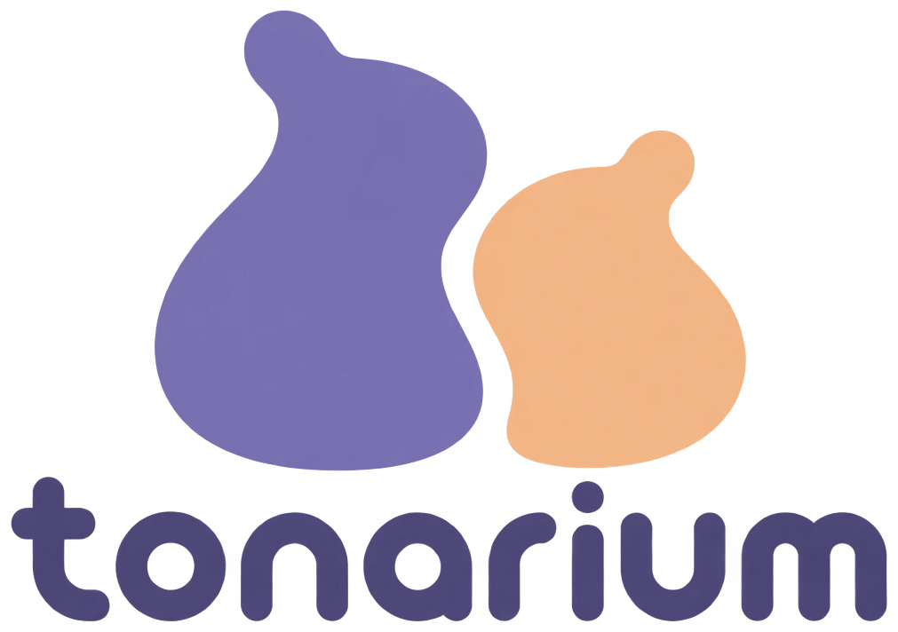

<p align="center"></p>

# Tonarium Prototype

2D（リスト・ウィンドウ・チャット・通話・配信視聴）と 3D（空間）を同じワールドのまま行き来できる体験検証用プロトタイプ。本番では捨てる前提。

## 構成
- `client/` Vite + React + TypeScript。3D は React Three Fiber。状態は zustand
  - `client/src/world/` ワールド画面（左のプレイヤー・アイテム、上の顔、右の通知・ログ、下のドック、背面のウィンドウ）
- `server/` Node + ws。オンラインのユーザーと、ワールドごとの状態（チャット・アイテム・アバター位置）をメモリに保持し、LiveKit のトークンも発行
- `shared/protocol.ts` WebSocket メッセージ型、`shared/places.ts` 位置と距離（クライアントとサーバーで共用）
- `worlds.json` ワールドの構成
- `client/public/brand/` ロゴ・ファビコン・OGP 画像。OGP の絶対 URL は、サーバーが `index.html` を返すときにアクセスされたドメインで埋める（`__ORIGIN__`）
- 音声・画面共有は LiveKit。本番は Coolify で自前の `livekit-server` を一緒に動かし、手元では Docker で開発用の LiveKit を動かす

設計上のポイント:
- LiveKit 接続は `client/src/net/livekit.ts` に1つだけあり、2D/3D の表示コンポーネントとは無関係に生きている → 表示切替で通話・配信が切れない
- 配信映像は1つの `<video>` を 2D のウィンドウと 3D スクリーン（VideoTexture）で共有 → 二重再生しない。音声は表示と無関係に1回だけ attach
- 2D の画面は「背面にウィンドウ、前面に半透明のパネル」。3D のときは背面が 3D 空間になり、前面のパネルはそのまま残る

## セットアップ
```bash
npm install
cp .env.example .env   # 手元の LiveKit（devkey / secret）を使う設定になっている
npm run livekit        # 開発用の LiveKit を Docker で起動（Docker Desktop が必要。止めるときは npm run livekit:stop）
```
LiveKit が動いていなくても、チャット・アイテム・3D は動く（通話と配信のみ無効。画面のドックの上に理由が出る）。
LiveKit Cloud を使う場合は `.env` の `LIVEKIT_*` をそのプロジェクトの値にする。

## ワールド構成の変更
`worlds.json` を編集する。
```json
{ "id": "lounge", "name": "ラウンジ", "topic": "ゆっくり話そう" }
```
- `id` は英数字で一意に。ワールドごとに別の LiveKit ルーム（`tonarium-<id>`）・3D空間・アイテム・チャットになる
- `npm run dev` 中は保存するとサーバーが再起動する（メモリ内のチャット・アイテムは消える）。`npm start` の場合は再起動が必要

## 使い方
- 名前を入れて「はじめる」→ ワールド選択画面でワールドを選ぶと入って通話につながる。ドックの切断ボタン（または設定の「ワールドを移動」）で選択画面に戻る
- マイクのミュートは未接続中でも切り替えられ、次に入ったワールドで反映される

### 画面
- **左：プレイヤー／アイテム** 自分から近い順に「すぐそば（〜3m）」「声が届く（〜15m）」「とおく」に分けて並ぶ。ついていっている人は相手の下にぶら下がる。近づいている人はうっすらオレンジ、離れていく人はうっすら水色に光る。行をクリックでプロフィール、… で操作（そばにいく・ついていく・つんつん、アイテムは手に持つ・ウィンドウを開く・しまう など）
- アイテムの「出す」で所持アイテム（全種類）から選んで「目の前に出す」。2D で入口の列にいるときは入口の内側に出る。カメラは 3D でのみ出せる
- **上：顔** 2D でウィンドウを何も開いていないときは、自分・すぐそば・声が届く人を画面中央にグリッドで大きく並べる。ウィンドウがあるときや 3D では上に、自分と、すぐそばの人を大きく（最大 4 人、発話中は緑の枠、直近 30 秒の発言を吹き出しで表示）、声が届く人を小さく（最大 3 人＋人数）。3D アバターの胸から上を描く（全員分を 1 枚のキャンバスで描いている。`client/src/world/Portraits.tsx`）。たたむと人数だけになる。左右のパネルを開閉しても位置は変わらない。顔を押すと、その人をウィンドウとして中央に大きく出す（プロフィールは顔の右上の「…」から）。つんつんされた人のタイルには指でつつく演出が出て、本人には音が鳴る
- **右：通知とログ** 通知（つんつん・ハンマーで叩かれた・フレンド申請。最新のアナウンスは上に固定）、ログ（チャットと入退室などのできごと）。送信範囲は「声の範囲」（送った時点で 15m 以内にいる人だけに届く）・「全体」・「アナウンス」（誰でも送れる）
- **下：ドック** マイク、画面共有、サウンドボード（近くの人に聞こえる。距離で小さくなる）、ウィンドウの「カンタン／フリー」、2D/3D 切り替え、切断
- 2D/3D の切り替えには 1〜2 秒の疑似ローディングが入る。長さはプロフィール設定の倍率（なし〜×3。端末に保存）で変えられる
- ログに貼った URL はリンクになり、OGP（タイトル・説明・画像）のカードが出る。開くときは確認が出て、新しいタブで開く。OGP はサーバーが取りに行く（`/ogp`。ローカル・プライベートなアドレスには行かない）
- 左と右のパネル、上の顔はたためる（ブラウザに保存）

### 画像・動画・YouTube の共有
- Ctrl+V かドラッグ＆ドロップで、画像（JPEG/PNG/GIF/WebP、10MB まで）・動画（MP4/WebM、50MB まで）・YouTube のリンクを共有できる。3D では目の前にアイテムとして出てチャットにも投稿され、2D ではチャットに投稿だけされる。大きすぎるものは送る前に断る（サーバーでも同じ上限を見る）
- チャット欄の添付ボタンからも画像・動画を送れる。チャットの画像・動画・YouTube には「アイテムにする」ボタンがあり、押すと目の前に出る
- ファイルはサーバーの `data/media/` に保存され、合計 1GB を超えたら古いものから消える
- 動画と YouTube はみんなで同じところを再生する（再生・一時停止・シークは全員に反映）。ウィンドウの下の操作バー、または 3D で板をクリックで操作する。音は 3D では距離で小さくなり、2D ではウィンドウを開いているときだけ鳴る
- YouTube は他サイトの動画なので 3D の板にテクスチャとして貼れない。本物のプレーヤーを板の位置・傾きに合わせて HTML で重ねている（手前の物に隠れない・裏側からは見えない）

### ウィンドウ
- 画面共有・カメラのライブ・ついていく人の視点・チェス・2048・キャンバス・付箋はウィンドウで開く。タイトルバーに「閲覧中」の人のアイコンが出る
- ドックで「カンタン」（既定。いちばん新しく開いた・押したものを大きく表示し、ほかは下に小さく並ぶ。小さい方を押すと入れ替わる）と「フリー」（重ねて表示・タイトルバーをドラッグで移動）を選べる（ブラウザに保存）
- アイテムのウィンドウの ✦（注目を集める）を押すと、ほかの人のアイテム欄のその行と 3D 空間のそのアイテムが 10 秒ほど光り、通知とログにも出る
- リストの「表示中」を押すと確認してから閉じる。画面共有は自動では開かない。リストや顔の「ライブ」を押すと開く（自分の共有も同じ）。最大化したウィンドウは前面のパネルより上に出る

### チェス
- 白から交互に指す共有盤です。参加登録や席の割り当てはなく、手番の色の駒を誰でも動かせます。
- 駒を選ぶと合法な移動先が表示されます。チェックを放置する手や、自分のキングを危険にさらす手は指せません。
- キャスリング、アンパッサン、4種類から選ぶ昇格に対応。チェックメイト、ステイルメイト、戦力不足、50手ルール、同一局面3回を判定します（引き分けは申告なしで自動終了）。
- 2D は手番・チェック・結果・直近の棋譜を表示。3D でも移動先・手番・結果・昇格の選択を表示します。「新しい対局」を2回押すと初期化します。
- サーバーが合法手と盤面の更新番号を確認し、全員に結果を配信します。同時操作のうち古い盤面に対する操作は反映しません。
- ルールの回帰テスト: `npm run test:chess`。ルール判定には [chess.js](https://github.com/jhlywa/chess.js) を使用しています。

### チェスAI
- 「出す」から「チェスAI」を選ぶと、共有チェスとは別のAI対戦盤を置けます。2D・3Dの両方に対応しています。
- 白は誰でも操作でき、黒はサーバーのAIが自動で指します。参加登録・外部API・APIキーは不要です。
- AIは駒の価値や展開を評価し、時間制限内で最大3手先まで探索する軽量版です。考慮中は表示が切り替わり、黒の駒を手動では動かせません。
- 昇格や勝敗判定は共有チェスと同じです。考慮中のリセット・片付けでは、古い応手を破棄します。

### プロフィール・フレンド
- 参加画面の丸いアイコン、ワールド選択画面の右上、ワールド内の設定「プロフィールを編集」から、アイコン・3D アバター・自己紹介を設定できる。どれも名前ごとにサーバーの `data/` に保存される（再起動しても残る）。認証はないので、同じ名前を入れた人は誰でも変えられる
- 他の人のプロフィールから フレンド申請（相手の通知で承認すると成立。名前の組で `data/friends.json` に保存）、ブロック（その人の声・チャット・通知・効果音が自分に届かなくなる。ブラウザに保存）、通報（`data/reports.log` に追記されるだけ）

### 3D アバター（お絵描きアバター）
- [oekaki-avatar](https://github.com/anthrotech-dev/oekaki-avatar) の形式。テンプレート（2048×1024）に描いた画像を 1 枚アップロードすると 3D アバターになる。oekaki-avatar で書き出した zip の `texture.png` と `manifest.json`（頭の大きさなどの調整値）も使える
- 未設定の人は `shared/avatar.ts` の `AVATAR_SAMPLES` から名前のハッシュで 1 つ選ばれる（今は `client/public/oekaki/sample.png` のみ）。サンプルを増やすときは画像を置いて配列に足す
- モデル・テンプレート・サンプルは oekaki-avatar から作者の許可を得て `client/public/oekaki/` に取り込んでいる

### 3D の操作（FPS 風）
- 画面をクリックするとマウスがロックされ、マウスで視点、WASD/矢印で移動。Esc でカーソルに戻る（ロック中は前面のパネルが薄くなって押せない）
- 操作はすべて画面中央の照準で行う: クリック = 操作、G = 持ち運ぶ/置く、X = 片付ける、Q = 手に持った物を置く
- 付箋をクリックするとカーソルに戻って編集欄が出る
- 置かれている 2D の人は、他の人やアイテムと重なると少しずつ押し出される（入口の列とついていっている間は除く）。2D の人がアイテムを出すときは、ほかの物や人と重ならない近くの場所に出る
- 3D には 2D でいた場所から入る（入口の列にいたなら入口のすぐ内側）。3D から 2D に戻ってもその場にとどまる（ドックの上の「入口に戻る」で列に戻れる）
- 2D で参加している人も同じアバターで、入口の外に並ぶか置かれた場所に立っている。ハンマーで叩けて、照準を合わせて G で持ち運び、好きな場所に置ける（声もそこから聞こえる）
- 自分のアバターは一人称では見えないが、カメラで撮ると写る（手に持って撮るときは除く）

### 空間オーディオ・ついていく
- ワールドの設定（左上の歯車）の「ブロードキャストモード」をオンにすると、そのワールドの全員に、距離に関係なく全員の声・サウンドボード・動画の音が聞こえ、「声の範囲」のチャットも全員に届く。誰でも切り替えられ、ログに出る
- 声は話している人との距離で大きさが変わる（2m までは等倍、15m で無音）。3D の人と、ついていっている 2D の人は左右にも振り分けられる。画面共有の音は空間化しない
- 2D の人は 3D の人に「ついていく」と、その人の少し後ろに小さくなって付いていき、そこからの音が聞こえる。ドックの上の「ライブをリクエスト」で相手に視点のライブを頼め、相手が通知の「ライブを始める」（またはドックの上の「視点をライブ」）で始めると、ついていっている人だけに視点が配信されてウィンドウで見える。画面共有やカメラのライブとは別なので同時に使える。ついてくる人がいなくなるか 2D に戻ると止まる
- 「そばにいく」は相手（アイテムなら置いてある場所か持っている人）の手前に移る。3D では瞬間移動する

### アイテム
アイテムの定義は `shared/items.ts`（状態・操作・リストに出すマークと色）、2D 画面は `client/src/items/panels.ts`、3D 表示は `client/src/view3d/items3d.tsx`。
- 付箋（2D/3D）: 2D ではウィンドウ、3D では空間内の看板。編集中は他の人に「編集中」と出る
- ピコピコハンマー（2D/3D）: 1本につき1人が持てる。3D では照準で拾い、アバターや入口に並ぶ 2D の人を叩く。2D では「手に持つ」→ マウスのところにハンマーが出て、リストや顔の人をクリックで叩き、相手のすぐそばに移る
- チェス（2D/3D）: ルールなし。クリックで駒を選び、もう一度クリックで移動
- キャンバス（2D/3D）: みんなで絵を描ける。ペン（6色・細/太）、消しゴム、全部消す、保存（ログに画像で投稿）
- カメラ（3D 専用）: 持っている間はファインダー表示でクリック = 撮影、L = ライブ配信、Q = 三脚に置く。三脚のカメラは照準で C = 撮影、L = 配信。写真はログに投稿される。ライブは 2D ではウィンドウ、3D ではカメラの上のモニターに映る
- 2048（2D 専用）: 全員で1つの盤面を操作。いちばん前のウィンドウなら矢印キーでも動かせる。3D では互換モードとして 2D 画面がパネルで置かれる

## 開発
```bash
npm run dev
```
http://localhost:5173 を開く。同じブラウザで別人として入るには `?as=b` のように付ける（名前はブラウザ共通で覚えるので、入る前に変える）。

## インターネット越しにつなぐ（cloudflared）
cloudflared は `winget install Cloudflare.cloudflared` で入る。表示された `https://*.trycloudflare.com` を参加者に共有する。

テスト本番（ビルド済みを配信。安定）:
```bash
npm start
cloudflared tunnel --url http://localhost:3001
```

開発中にそのまま外から試す（コードの変更がすぐ反映される）:
```bash
npm run dev
cloudflared tunnel --url http://localhost:5173
```
`npm run dev` 中に 3001 をトンネルすると案内メッセージが出るだけなので、5173 に向けること。
手元の LiveKit（`ws://localhost:7880`）にはトンネル越しの人はつながらない（音声・映像は UDP で直接やりとりするため）。外の人と通話まで試すときは Coolify にデプロイするか、`.env` を LiveKit Cloud の値にする。
cloudflared 以外（ngrok など）を使う場合は、`.env` の `ALLOWED_HOSTS` にホストを足す（例: `ALLOWED_HOSTS=.trycloudflare.com,.ngrok-free.app`。保存すると開発サーバーが再起動する）。

## Coolify にデプロイする
リポジトリに `Dockerfile` と `docker-compose.yml` があるので、Coolify でそのまま動く。

アプリ（`tonarium`）と LiveKit（`livekit`）の 2 つのサービスが立つ。

1. サーバーのファイアウォール（VPS のセキュリティグループなど）で **TCP 7881・UDP 7882・UDP 3478** を開ける（LiveKit の音声・映像と TURN。Coolify の外の設定）
2. DNS で LiveKit 用のサブドメイン（例: `livekit.example.com`）をサーバーに向ける
3. Coolify で新しいリソースを作り、このリポジトリ（ブランチ）を選ぶ。ビルドパックは **Docker Compose**（`docker-compose.yml`）
4. 環境変数を設定する
   - `LIVEKIT_DOMAIN`: LiveKit 用のサブドメイン（`livekit.example.com`。`https://` は付けない）
   - `LIVEKIT_API_KEY`: 好きな文字列（例: `tonarium`）
   - `LIVEKIT_API_SECRET`: 32 文字以上のランダムな文字列（例: `openssl rand -base64 32` の結果）
5. ドメインを設定する
   - `tonarium` サービス: アプリのドメイン（`SERVICE_FQDN_TONARIUM_3001` によりポート 3001 に転送。自動で付かなければ `https://<ドメイン>:3001` の形で指定）
   - `livekit` サービス: `https://<LIVEKIT_DOMAIN>:7880`（シグナリングの wss がここを通る）
6. デプロイ。`/healthz` がヘルスチェックに使われる。通話に入れないときは、ドックの上に出る理由と `livekit` サービスのログを見る

メモ:
- HTTP・WebSocket（`/ws`）・LiveKit トークン（`/token`）はすべて同じポート。HTTPS は Coolify（Traefik）が付けるので、マイク・画面共有もそのまま使える
- アイコン・3D アバター・自己紹介・フレンド・通報は `tonarium-data` ボリューム（`/app/data`）に保存されるので再デプロイしても残る。それ以外の状態（チャット・アイテムなど）はメモリ内だけなので、再デプロイ・再起動で消える。インスタンスは 1 つで動かすこと（複数にすると部屋が分かれる）
- LiveKit の設定は `docker-compose.yml` の `LIVEKIT_CONFIG` にある。サーバーの外向きの IP は自動で調べる（`use_external_ip`）。社内ネットワークなど UDP が通らない人向けには TURN（UDP 3478）も動く
- LiveKit Cloud に戻すときは、`livekit` サービスを消して `tonarium` の `LIVEKIT_URL` を Cloud の URL にする
- ワールド構成を本番だけ変えたいときは、`docker-compose.yml` のコメントにある `WORLDS_FILE` とボリュームを使う
- Dockerfile だけで使う場合（Coolify の Dockerfile ビルドパックや手元）:
  ```bash
  docker build -t tonarium .
  docker run --rm -p 3001:3001 -e LIVEKIT_URL=... -e LIVEKIT_API_KEY=... -e LIVEKIT_API_SECRET=... tonarium
  ```
  （この場合 LiveKit は別に用意する）

## 参加者への注意
- デスクトップ版 Chrome / Edge 推奨
- 配信の音声: タブ共有ならタブ音声、Windows で画面全体を共有すると PC の音声も流れる（ウィンドウ単位の共有では音声なし）
- サーバーを再起動するとワールドの状態（チャット・アイテム）は消える
